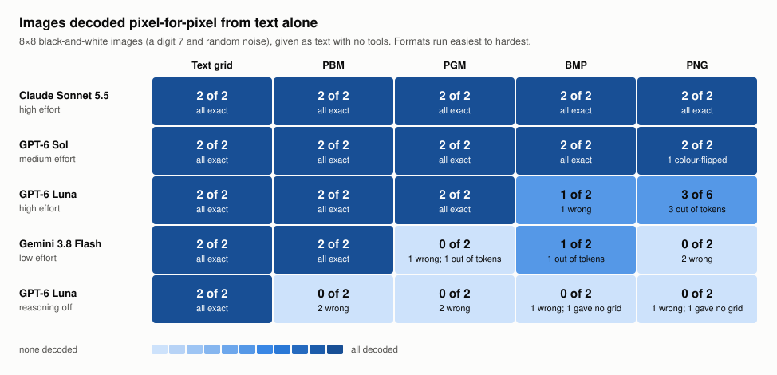
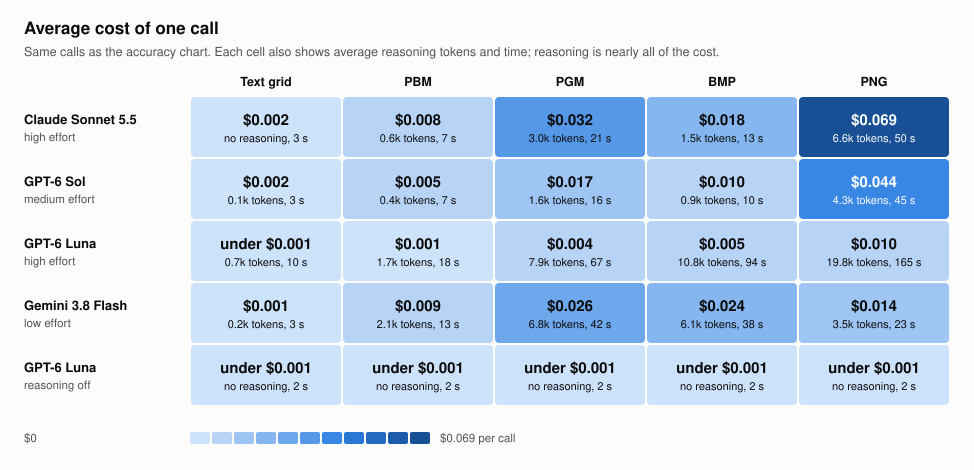

# Can a model read a picture it can't see?

**Results page:** https://atharva-729.github.io/base64-image-probe/ · **Results report:** [results/api_runs/README.md](results/api_runs/README.md)

We gave language models the base64 text of tiny image files, with no tools and no image input, and asked them to reconstruct every pixel. Two of four models (Claude Sonnet 5.5 and GPT-6 Sol) decoded every image in every format, including a compressed PNG of random noise. It only works when the model reasons, and it costs 6–7 cents and about a minute per PNG. Total spend was $0.97 over 128 API calls.

This README covers what we were trying to find out, the technical background, and what actually happened, including the wrong turns.



## The question

A model normally "sees" an image through a vision encoder. But an image file is a sequence of bytes, and bytes can be written as text. Models are fluent at reading base64 when it encodes text. Does that extend to decoding an image file in their reasoning and recognising the picture?

If it does, the image is being read entirely through the text pathway. That says something about how far a model's reasoning goes on raw binary data. It is a capability probe. It is not a proposal for how to send images: attaching an image normally is far cheaper and more reliable.

## Technical background

### Base64

Base64 writes every 3 bytes as 4 characters from a 64-character alphabet (`A–Z a–z 0–9 + /`), 6 bits per character. Decoding one character means looking up its 6-bit value; decoding a file means doing that for every character and regrouping the bits into bytes. A model has no base64 decoder. It has to do the lookups and the regrouping in its reasoning, and one slip shifts everything after it.

### The five formats

The same 8×8 black-and-white picture was stored five ways. The file format decides how much work sits between the base64 and the pixels.

| Format | What the bytes are | Base64 length (8×8) | Work to decode |
|---|---|---|---|
| Text grid | Not a file: 8 lines of `0`/`1` characters | 71 characters, no base64 | None. This is the control. |
| PBM (P4) | 7-byte header `P4\n8 8\n`, then 1 bit per pixel, 1 = black, rows padded to a byte | 20 | Base64 → 15 bytes → read 8 bytes as bit rows |
| PGM (P5) | 11-byte header `P5\n8 8\n255\n`, then 1 byte per pixel, 0 = black, 255 = white | 100 | Same idea, but 64 pixel bytes to decode instead of 8 |
| BMP (1-bit) | 62 bytes of headers and a 2-colour palette, then rows stored bottom-up, each padded to 4 bytes | 128 | Skip the header, read rows, reverse their order, apply the palette |
| PNG (1-bit) | Signature, IHDR chunk, IDAT chunk holding zlib-compressed data, IEND, each chunk with a CRC | 100–108 | Everything above, plus decompression and un-filtering (below) |

### What decoding a PNG involves

PNG is the hard one, and it is hard in three layers.

1. **Chunks.** Find the IDAT chunk and take its payload: a 2-byte zlib header, a DEFLATE stream, a 4-byte checksum. For the 8×8 images the payload is about 24 bytes.
2. **DEFLATE.** The stream is read bit by bit, least significant bit first. A block is one of three kinds:
   - **Stored:** the bytes are copied as they are. No decompression at all.
   - **Fixed Huffman:** symbols are coded with a table built into the standard, 7 to 9 bits each, and may be back-references ("copy 3 bytes from 2 back").
   - **Dynamic Huffman:** the block first describes its own code tables, which must be rebuilt before any data can be read.
3. **Filters.** Decompression gives one filter byte plus the pixel bytes for each row. Filter 0 means the row is stored as is. Filter 2 ("Up") means each byte is stored as its difference from the byte above, so rows must be undone in order. Filters 1 and 4 (Sub, Paeth) also appear in our files.

One more trap: in a 1-bit grayscale PNG, 0 is black. Our prompt asks for 1 = black. A model that decodes perfectly and forgets to flip produces an exact negative.

The encoder picks the block type, and this turned out to matter. Random noise does not compress, so two of our 16×16 PNGs use stored blocks and are far easier than the smaller 8×8 ones that use fixed Huffman.

## How the experiment works

### Images

Seven hand-defined shapes (digits 1, 7, 0; an X, a square, a diagonal, a circle) and two random-noise images, each at 8×8, 16×16 and 32×32. The runs used four of them: `digit_7`, `shape_x`, `noise_a`, `noise_b`.

The noise images are the control against guessing. A 7 can be guessed from a vague impression. Random pixels cannot, and chance is 50% per pixel, so an exact noise reconstruction can only come from decoding.

### Prompt

One prompt variant was used for all API runs, the one that makes the model show its work:

```
The following is a base64-encoded PNG image file. The image is 8x8 pixels, black and white.
Do not use any tools or run any code. First reconstruct the pixel grid, writing one row per
line using 1 for a black pixel and 0 for a white pixel. Then tell me what the image shows.
Then give your confidence (low/medium/high).

iVBORw0KGgoAAAANSUhEUgAAAAgAAAAIAQAAAADsdIMmAAAAGElEQVR4nGNoZPjJxMTEwPSHiYHpAxMHAB5qA32rRw2yAAAAAElFTkSuQmCC
```

Asking for the grid first is what makes the result measurable: the grid is compared pixel by pixel with the truth, so "decoded" and "guessed the name" are separated.

### No tools

Requests go to the OpenRouter chat completions API as a single user message. No tools, no system prompt, no temperature setting. The model can only return text, so a correct grid was worked out in its reasoning. Reasoning effort is set per call with OpenRouter's `reasoning.effort`.

### Scoring

[score.py](score.py) finds the last block of N lines of N `0`/`1` characters in each reply and compares it with the true grid.

- **Exact** means every pixel is right. This is the number to trust.
- **Pixel accuracy** is the share of pixels right. It flatters sparse shapes: an all-white reply scores about 80% on a digit.
- **Inverted accuracy** is the same with the reply's colours flipped. An inverted-exact grid counts as decoded in the summary charts, and is labelled.

### Guardrails on spending

The whole project had a $5 key and a self-imposed limit of $1.25. [run_openrouter.py](run_openrouter.py) enforces it:

- Every request and full reply is appended to [responses.jsonl](responses.jsonl).
- A call is identified by model, prompt, effort and run number, and is never sent twice.
- Every call has a `max_tokens` cap. Reasoning is billed as output, so cap × output price bounds what one call can cost.
- Before each call the runner checks whether that call's worst case could cross the phase budget or the total, and stops if so.
- `--dry-run` lists every pending call with its worst-case cost and sends nothing.
- No automatic retries.

## What happened

### 1. A first round by hand, in chat apps

The PNG of the 7 was pasted into five chat apps. Claude Opus 5.5 (43 s) and Gemini 3.8 Flash with extended thinking (5 min 50 s) returned the exact grid and "7". ChatGPT returned the exact grid with colours inverted and could not name it. Two Gemini models answering instantly invented a "hollow circle" and a "letter C", both with high confidence.

The original plan had called PNG "near impossible". That was wrong for images this small: the compressed data is 24 bytes of fixed Huffman.

Raw replies are in [results/8x8_digit_7_png_showwork/](results/8x8_digit_7_png_showwork/) and the first write-up is [initial_analysis.md](initial_analysis.md).

### 2. The objection

My manager's response was that a chatbot is an agent with access to code: it can save the string, decode it to an image, look at it with vision, and report back. A correct answer from a chat app shows nothing about decoding by reasoning. The experiment had to be rerun through the API, with everything logged and cached so no request is paid for twice.

### 3. Pilot: eight calls, three surprises

The same PNG went to four models at their lowest reasoning setting and at medium.

- **Reasoning cannot always be switched off.** OpenRouter marks Claude Sonnet 5.5 and Gemini 3.8 Flash as reasoning-mandatory; their floor is `low`. The GPT-6 models go down to `none`.
- **Sonnet did not reason at all at low or medium** (zero reasoning tokens) and declined to give a grid. A rerun gave the same, with two replies offering a grid labelled as a guess. At `high` it reasoned for 6,327 tokens and decoded all 64 pixels.
- **Gemini at medium used its whole 12,000-token cap** and returned a tidy, invented decode of an "X" with high confidence, for 4.5 cents. Medium was dropped for Gemini because of cost. At `low` it did no reasoning and said "smiley face".

GPT-6 Sol at medium reproduced the ChatGPT result from round one: every pixel right, colours inverted, and it still named "a white 7 on a black background".

### 4. The full sweep on the cheap model

GPT-6 Luna costs $0.50 per million output tokens, so it got the wide grid: four images × five formats × three efforts at 8×8, plus 16×16 and repeat runs. Exact decodes out of 4:

| Format | Reasoning off | Low | High |
|---|---|---|---|
| Text grid | 4 | 4 | 4 |
| PBM | 0 | 2 | 4 |
| PGM | 0 | 0 | 4 |
| BMP | 0 | 4 | 2 |
| PNG | 0 | 0 | 5 of 12 (three runs) |

With reasoning off it got 0 of 16 encoded images, at 38–67% pixel accuracy, and stated high confidence on 6 of them. At high effort it decoded the noise images as well as the shapes in PBM and PGM. PGM took about four times the reasoning of PBM for the same picture, because the base64 is five times longer.

### 5. The wall, and doubling the cap

On PNG at high effort, 15 of Luna's 16 calls spent the entire 12,000-token cap on reasoning and returned an empty reply. An empty reply is billed in full.

The cap was doubled to 24,000 and the cut-off calls were resent. To make that possible the runner was changed so that a reply cut off with no answer is resent only when the current cap is larger than the one it failed at. Of the 15 retries, 6 came back exact, 1 declined after 22,790 tokens, and 8 were cut off again. One call timed out along the way; the runner stopped, logged it, and it was resent.

Two things came out of this:

- **Every grid Luna did produce on PNG was pixel-perfect**, including one compressed noise image. It finishes correctly, declines, or runs out of tokens. It never returned a wrong grid.
- **The compression inside the PNG predicts the outcome.** Both 16×16 PNGs that use stored (uncompressed) blocks were decoded exactly. The fixed-Huffman 8×8 ones succeeded on some runs. The one dynamic-Huffman file was not decoded. This was checked by reading the block type from the files; that it explains the pattern is an inference from eight files.

In total 23 calls were cut off with no answer, costing $0.19, about a fifth of everything spent.

### 6. A wrong turn: "so is BMP better than PNG?"

Partway through, the Luna results looked like advice: convert PNGs to BMP to save tokens or get better answers. They are not.

- BMP does not save tokens. Its base64 is longer than the PNG's (128 characters against 100–108), and for a real photo an uncompressed BMP would be many times larger.
- What the data shows is narrower: when a model has to read raw file bytes, uncompressed formats are within reach of a small model and compressed ones mostly are not.
- None of it applies to normal use, where the image goes through vision input.

### 7. Changing the last phase to answer the real question

The original last phase covered two formats for the three pricier models. What was actually wanted was a model × format comparison of accuracy and cost, and only Luna had all five formats. The phase was redesigned: Sonnet (high), Sol (medium) and Gemini (low) on all five formats, on the 7 and one noise image, with the 16×16 cells dropped to pay for it. The caps for Sonnet and Sol were raised to 12,000, which mattered: Sol needed 8,881 tokens for the noise PNG.

### 8. Final results

| Model | Effort | Text grid | PBM | PGM | BMP | PNG | Avg. cost per PNG call |
|---|---|---|---|---|---|---|---|
| Claude Sonnet 5.5 | high | 2 of 2 | 2 of 2 | 2 of 2 | 2 of 2 | 2 of 2 | $0.069 |
| GPT-6 Sol | medium | 2 of 2 | 2 of 2 | 2 of 2 | 2 of 2 | 2 of 2 | $0.063 |
| GPT-6 Luna | high | 2 of 2 | 2 of 2 | 2 of 2 | 1 of 2 | 3 of 6 | $0.010 |
| Gemini 3.8 Flash | low | 2 of 2 | 2 of 2 | 0 of 2 | 1 of 2 | 0 of 2 | $0.012 |
| GPT-6 Luna | off | 2 of 2 | 0 of 2 | 0 of 2 | 0 of 2 | 0 of 2 | under $0.001 |

Two images per cell (the 7 and `noise_a`, 8×8); Luna's PNG cell has three runs of each.

- Sonnet and Sol decoded everything, including the PNG of random noise. Sol was cheaper on every format.
- PNG cost Sonnet and Sol 6–7 cents and about a minute. The same picture as PBM cost under a cent and a few seconds.
- Gemini at low effort got PBM right and failed PGM and PNG, twice with a confident wrong answer.



Full numbers, per-model detail and caveats are in the [results report](results/api_runs/README.md).

## What we learned

1. **Models can decode a small image from its bytes by reasoning alone.** With tools unavailable, two models reconstructed compressed PNGs of random noise exactly.
2. **Reasoning is the switch.** Without it, accuracy is at chance. The same model on the same files produces exact decodes once it reasons.
3. **Format and length set the cost.** Compression is the expensive part, and within PNG the block type matters more than the image size.
4. **Decoding is not recognising.** Luna decoded the X exactly and called it "a white diamond on a black background", and decoded the 7 exactly and described "a short horizontal bar with a zigzagging stem".
5. **Models differ in what they do when they don't reason.** Gemini and Luna often gave confident wrong answers. Sonnet refused or labelled its answer a guess.

## What we got wrong or would change

- **"PNG is near impossible"** was the starting hypothesis. For tiny images it is merely expensive.
- **The colour convention in the prompt is a trap.** Asking for 1 = black when PNG stores 0 = black caused inverted-but-exact grids. Decoding and interpretation should be scored separately, which the scorer now does.
- **Token caps were set too low at first** for the cheap model, and the cut-off calls were pure waste. A cap bounds cost, but it also bounds how long a model can think, so a failure at the cap means "did not finish", not "cannot".
- **Gemini is under-tested.** Its medium setting was dropped after one expensive failure, and its chat-app success with extended thinking was never reproduced through the API.
- **The name check is a keyword match** and is unreliable. Only the pixel scores should be trusted.

## Limits

- Sonnet, Sol and Gemini have one run per cell on two images. The counts are small.
- All images are 8×8 or 16×16, black and white, 20–130 characters of base64. A real photo is hundreds of thousands of characters. Nothing here says the result carries over.
- Models were not run at the same effort level, because each has a different range. Each is reported at a setting where it reasons.
- The 32×32 images, the blind and guided prompt variants, and five of the nine images were generated but never run.

## Repository

| Path | What it is |
|---|---|
| [make_images.py](make_images.py) | Builds the test images into `images/` |
| [make_prompts.py](make_prompts.py) | Encodes each image five ways and writes `prompts/` and `encodings.json` |
| [run_openrouter.py](run_openrouter.py) | Sends prompts through OpenRouter with logging, caching and budget stops |
| [responses.jsonl](responses.jsonl) | Every request and full reply, including reasoning text where returned |
| [score.py](score.py) | Scores replies into [results.csv](results.csv) |
| [make_table.py](make_table.py) | Builds the two heatmaps and the comparison table |
| [make_site.py](make_site.py), [site_template.html](site_template.html) | Build the results page in `docs/` |
| [results/api_runs/](results/api_runs/) | The results report, charts and table |
| [results/8x8_digit_7_png_showwork/](results/8x8_digit_7_png_showwork/) | Raw replies from the first, chat-app round |

### Running it

```
python make_images.py
python make_prompts.py
python run_openrouter.py --check-key           # key limit and usage, free
python run_openrouter.py --phase 1 --dry-run   # list calls and worst-case cost, free
python run_openrouter.py --phase 1             # pilot
python run_openrouter.py --phase 2             # GPT-6 Luna sweep
python run_openrouter.py --phase 3             # other models, all formats
python score.py
python make_table.py
python make_site.py
```

Put an OpenRouter key in `.env` (copy `.env.example`); git ignores it. With the committed `responses.jsonl` in place every call is already cached, so the phases send nothing and cost nothing.

## Related ideas from the same discussion

- **Multi-image order:** when given several images, do models and harnesses keep track of which is "image 1" and "image 2", especially when filenames conflict with position?
- **Harness PDF handling:** do coding agents read PDFs directly or convert them with a tool first?
- **The practical version of this question:** send the same picture as base64 text and as a normal attachment, and compare accuracy and token cost. We expect the attachment to win by a wide margin, but did not measure it.
